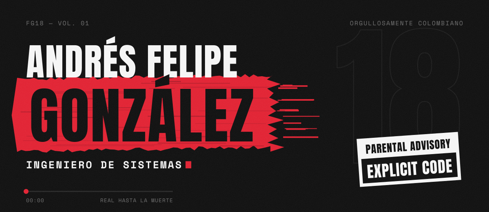
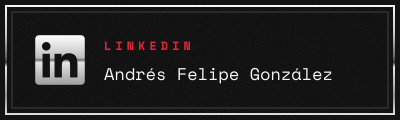
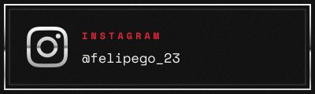
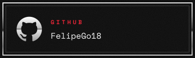
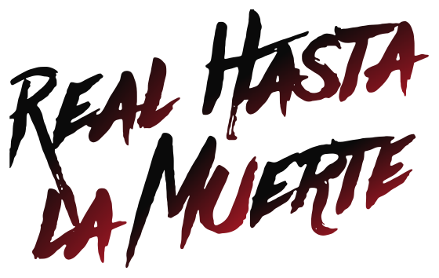

### Redes sociales

 

  <picture>
    <source media="(prefers-color-scheme: dark)" srcset="./assets/rhlm-dark.svg">
    
  </picture>

Arte generado con código propio en <code>scripts/</code> · Anton, Space Mono y UnifrakturMaguntia bajo licencia OFL · logos en <code>assets/ICONS-LICENSE.md</code>
