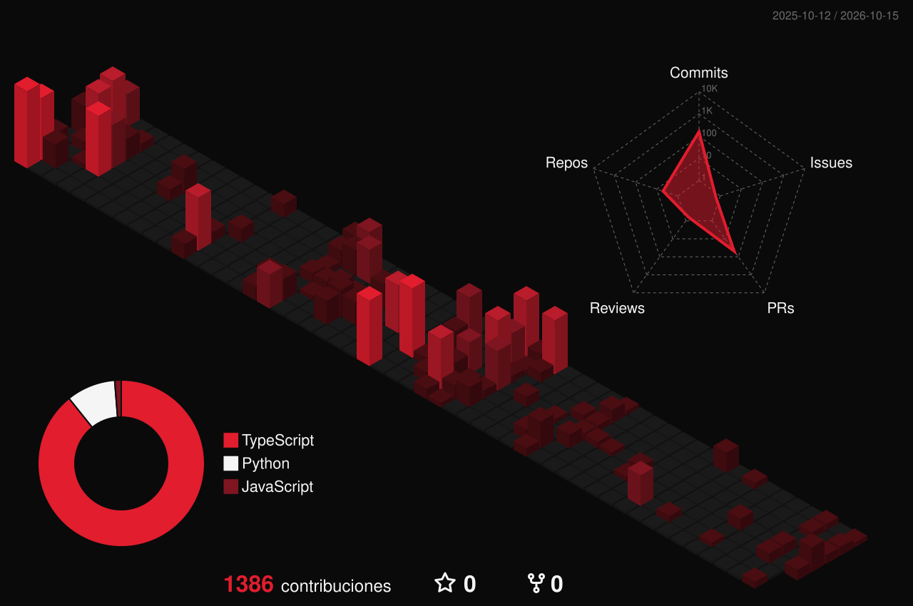

Construyo soluciones tecnológicas e integro sistemas. Me mueve crear cosas, automatizar lo que se repite y todo lo que conecte software con hardware, sobre todo el IoT.

### Producido con

 

 

 

 

Claude Code · Codex · Warp · Antigravity · Cisco Packet Tracer · k6 · FFmpeg · WSL

### Booking

[LinkedIn](https://www.linkedin.com/in/andres-felipe-gonzalez-garzon-1623a128b/) · [Instagram](https://www.instagram.com/felipego_23/) · [GitHub](https://github.com/FelipeGo18)

 

  <picture>
    <source media="(prefers-color-scheme: dark)" srcset="./assets/rhlm-dark.svg">
    
  </picture>

Arte generado con código propio en <code>scripts/</code> · Anton y Space Mono bajo licencia OFL
