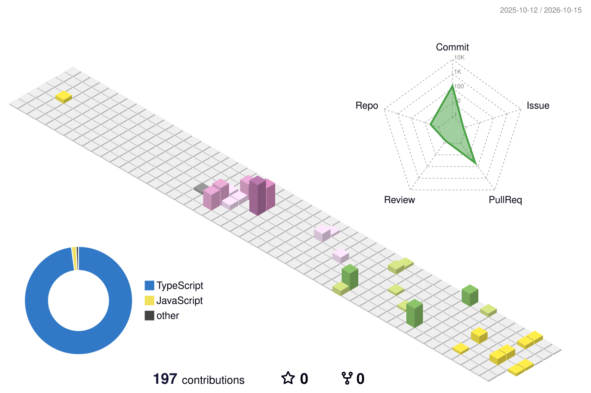

Construyo soluciones tecnológicas e integro sistemas. Me mueve crear cosas, automatizar lo que se repite y todo lo que conecte software con hardware, sobre todo el IoT. Siempre hay algo nuevo por aprender.

Orgullosamente colombiano.

### Ahora mismo

- **AgroSense**: con el equipo RealE4Life, para el NASA Space Apps Challenge 2026. Una web que usa datos satelitales de la NASA para que los agricultores planeen la rotación de sus cultivos.
- **LaboRemoto**: un laboratorio remoto para la Universidad Piloto de Colombia. Es una app de escritorio en Rust y Tauri desde la que se controlan Raspberry Pi, Arduino y robots, con terminal SSH, escritorio remoto e IA integrada.
- Microservicios en .NET con Keycloak, Kong y Kubernetes en el trabajo.

### Datos curiosos

- Monto topologías de red en Cisco Packet Tracer pidiéndoselas a una IA por MCP.
- Tengo una herramienta propia que transcribe audio y video con Whisper.
- Mi Windows está modificado con Windhawk. Si algo se puede personalizar, lo personalizo.

### Stack

 

 

 

### Herramientas

Claude Code · Codex · Warp · Antigravity · Cisco Packet Tracer · k6 · FFmpeg · WSL

### Racha

<picture>
  <source media="(prefers-color-scheme: dark)" srcset="https://streak-stats.demolab.com?user=FelipeGo18&hide_border=true&background=0D1117&ring=A78BFA&fire=A78BFA&currStreakLabel=A78BFA&currStreakNum=E6EDF3&sideNums=E6EDF3&sideLabels=8B949E&dates=8B949E&stroke=30363D&locale=es">
  
</picture>

### Contribuciones

<picture>
  <source media="(prefers-color-scheme: dark)" srcset="./profile-3d-contrib/profile-night-rainbow.svg">
  
</picture>

<picture>
  <source media="(prefers-color-scheme: dark)" srcset="https://raw.githubusercontent.com/FelipeGo18/FelipeGo18/output/github-snake-dark.svg">
  
</picture>

### Contacto

[LinkedIn](https://www.linkedin.com/in/andres-felipe-gonzalez-garzon-1623a128b/) · [Instagram](https://www.instagram.com/felipego_23/) · [GitHub](https://github.com/FelipeGo18)

 

  <picture>
    <source media="(prefers-color-scheme: dark)" srcset="./assets/rhlm-dark.svg">
    
  </picture>

